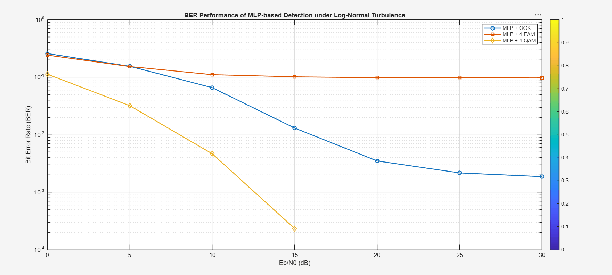
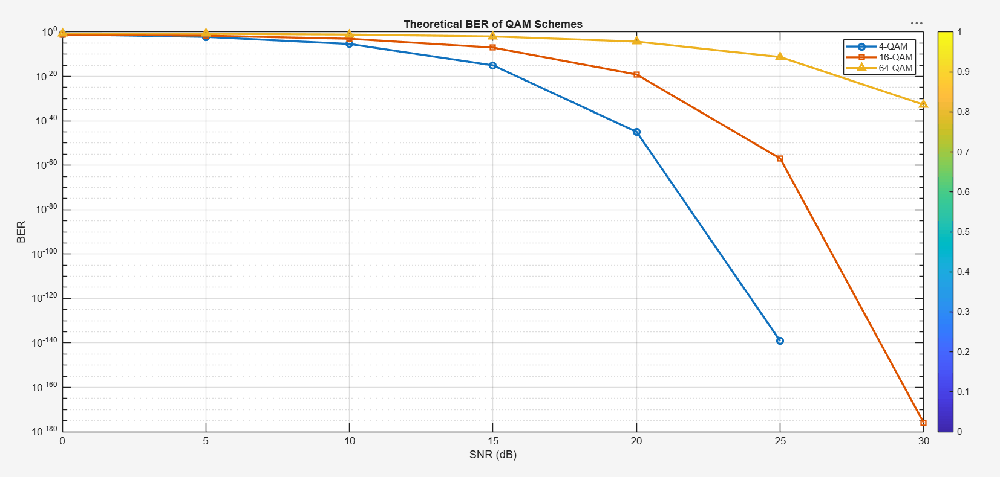
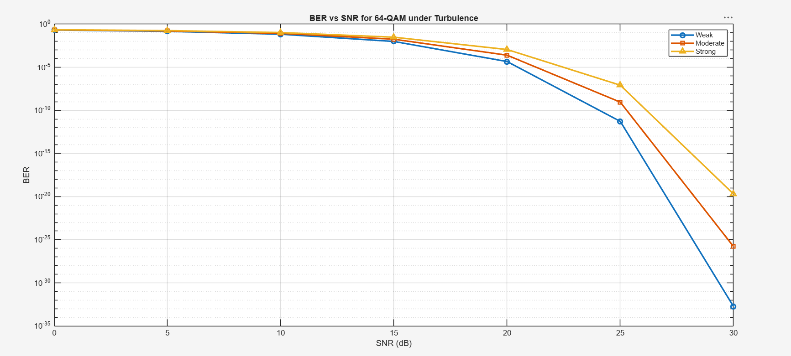
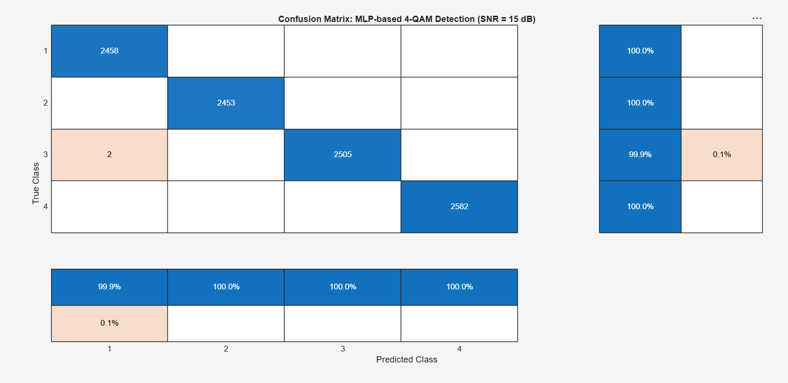

# FSO Communication: MLP Symbol Detection

A MATLAB simulation of free-space optical (FSO) communication under log-normal atmospheric turbulence. It trains shallow multilayer perceptrons (MLPs) to classify OOK, 4-PAM, and 4-QAM symbols, then compares their simulated error rates across a range of signal-to-noise ratios.

## What it covers

- Log-normal fading channel model for weak turbulence
- MLP-based symbol classification for OOK, 4-PAM, and 4-QAM
- Simulated error-rate comparison across SNR values
- Theoretical QAM reference curves and a 4-QAM confusion matrix

## Requirements

- MATLAB
- Statistics and Machine Learning Toolbox (`fitcnet`)
- Communications Toolbox (`qfunc`)

## Run

Open MATLAB in this folder and run:

```matlab
FSO_Sim
```

The script opens four figures. Random data generation uses a fixed seed (`42`) so runs are reproducible in a compatible MATLAB environment.

## Results

### MLP detection comparison



### Theoretical QAM reference



### 64-QAM across turbulence levels



### 4-QAM confusion matrix



## Metric note

The submitted MLP comparison image labels its vertical axis BER, but the simulation counts incorrect symbols for 4-PAM and 4-QAM. Interpret those traces as symbol error rate (SER); for binary OOK, SER equals BER. The separate QAM reference curves are theoretical and are not the same experiment as the turbulence simulation.

## Scope

This is an educational simulation, not a field-validated optical link or a production receiver. The channel and noise assumptions are simplified; results depend on the selected model parameters and MATLAB toolboxes.

## Repository topics

`free-space-optics` · `fso-communication` · `matlab` · `machine-learning` · `optical-wireless`

